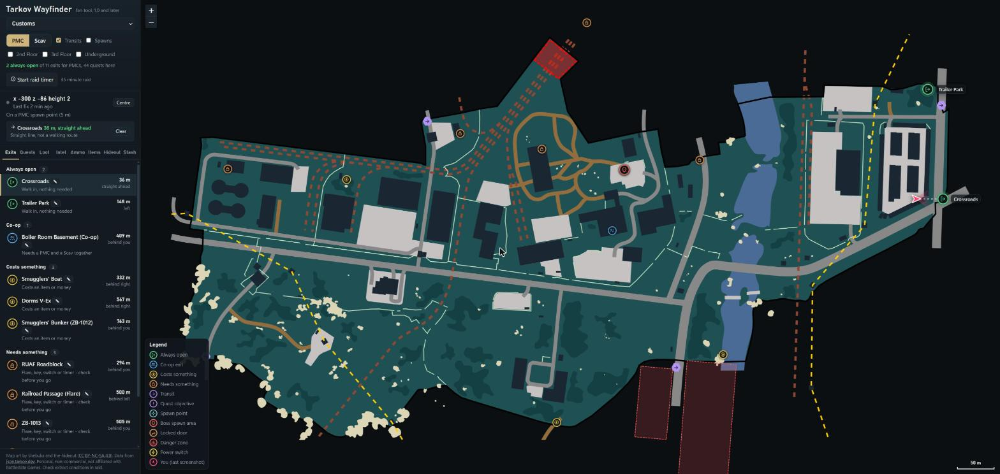
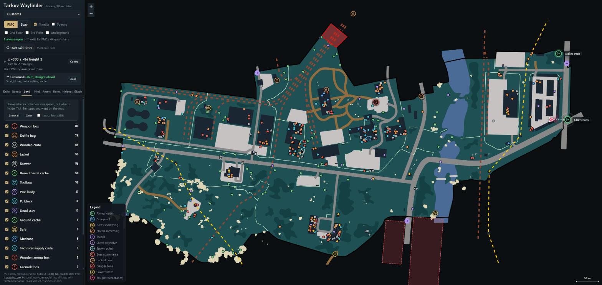
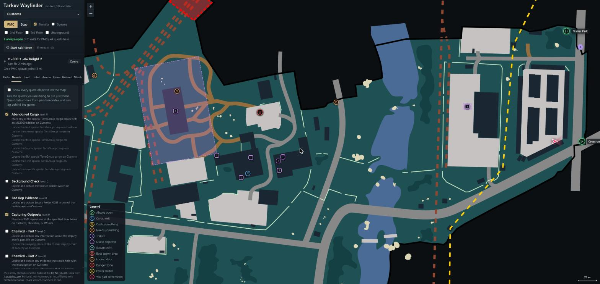
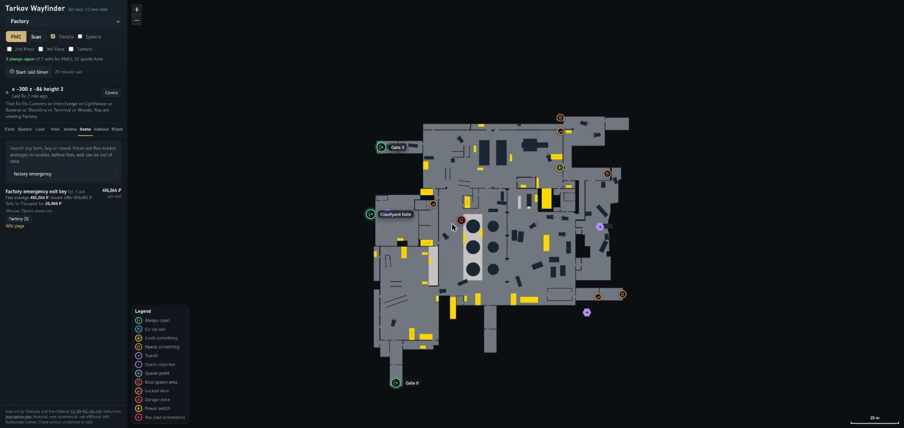

# Tarkov Wayfinder

A free, non-commercial fan tool for **Escape from Tarkov** (1.0 and later). It runs on your own computer and helps you learn the maps and plan your raids.

- **Maps with exits.** Every extract and transit, with the always-open ones highlighted in green. Pick PMC or Scav.
- **Where am I.** Take an in-game screenshot and your position and facing appear on the map, with the distance and direction to any exit.
- **Quests, loot, bosses, keys.** Quest objectives you can pin, container spots, boss spawn chances, danger zones, locked doors by key, power switches.
- **Items and ammo.** Flea and trader prices, price per slot, which doors a key opens, and an ammo table.
- **Hideout.** Station levels, a shopping list for the upgrades you plan, and a craft profit table.
- **Stash value.** Read a screenshot of your stash and total what it is worth (it makes mistakes, you check them).
- **Raid timer** and a **notes** field on each exit.



## Screenshots

| | |
|---|---|
|  **Intel**: boss spawn chances, minefields, locked doors by key |  **Loot**: where containers can spawn, filtered by type |
|  **Quests**: tick a quest to pin its objectives |  **Items**: prices, and which doors a key opens |
|  **Hideout**: upgrade shopping list and craft profits |  **Ammo**: damage, penetration and armour damage |

The screenshots use sample positions, not a real raid.

> Not affiliated with, endorsed by, or connected to Battlestate Games. Escape from Tarkov is a trademark of Battlestate Games Limited. This is an unofficial fan project.

## Quick start

You need [Node.js](https://nodejs.org) 18 or newer. There is nothing else to install.

```
git clone https://github.com/13thrule/tarkov-wayfinder.git
cd tarkov-wayfinder
node server.js
```

Then open <http://localhost:8801>. On Windows you can also double-click `start.bat`.

The first run downloads the map art and game data (a minute or two, needs internet). After that it starts straight away.

### Set up the screenshot key

1. In Tarkov go to **Settings > Control** and set **Make screenshot** to a key you like (mouse 3 works well). Plain PrintScreen is often grabbed by Windows, so a different key is easier.
2. In a raid, press that key. Your arrow appears on the map. Pick the map yourself, the screenshot does not say which map you are on.

The app finds your screenshots folder automatically (`Documents\Escape from Tarkov\Screenshots`, including OneDrive-redirected Documents). If yours is somewhere else, set the `EFT_SCREENSHOTS` environment variable to the folder.

### Stash value

Open your stash in game, take a screenshot with your screenshot key, then press **Read my latest in-game screenshot** on the **Stash** tab. The first time it prepares about 5,000 item icons (a few minutes), then it is quick. Check every row: it cannot read weapons or stack sizes, and some items look alike. Rows it is unsure about stay out of the total until you press **Looks right**.

## What it does with your files (please read)

- The server only listens on `127.0.0.1`, so only your own computer can use it.
- To find your position it reads the **file name** of your newest in-raid screenshot. Tarkov puts your coordinates in that name. **After reading it, the app deletes that screenshot file.** This keeps your folder from filling up. Set `EFT_KEEP_SHOTS=1` to turn deleting off.
- Menu screenshots (such as your stash) have no coordinates in the name and are never deleted.
- The Stash tab reads the pixels of a screenshot only when you ask it to.
- It does **not** read game memory, inject anything into the game, or press keys for you. It is a separate program that looks at files the game already saved.

There is no official statement from Battlestate Games about tools that read screenshot file names. Use it at your own risk. If you want to be extra careful, use only the map, quest, loot, item and hideout tabs, which need no files from your game.

## Data and credits

Nothing from the game is included in this repository. Everything is downloaded on your machine when you first run it.

| What | From | Terms |
|---|---|---|
| Game data (extracts, loot, bosses, quests, items, hideout) | [json.tarkov.dev](https://json.tarkov.dev), by the [tarkov.dev](https://tarkov.dev) team | Free to build tools on |
| Map art | [tarkov-dev-svg-maps](https://github.com/the-hideout/tarkov-dev-svg-maps), mainly by Shebuka | CC BY-NC-SA 4.0, **no use in cheats or radars** |
| Map settings (bounds, rotation) | [tarkov-dev](https://github.com/the-hideout/tarkov-dev) | MIT |
| Item art | assets.tarkov.dev | fetched to your computer for the stash reader |
| The idea of reading position from screenshot file names | [TarkovMonitor](https://github.com/the-hideout/TarkovMonitor) | GPL-3.0 (inspiration only, no code copied) |
| Always-open extract list | [Official EFT Wiki](https://escapefromtarkov.fandom.com), checked by hand | CC BY-SA |
| Map library | [Leaflet](https://leafletjs.com) (bundled in `public/vendor`) | BSD 2-Clause |

Because the map art is **non-commercial** and **share-alike**, this project is non-commercial too. See below.

## Licence

Wayfinder's own code is under the [PolyForm Noncommercial License 1.0.0](LICENSE). You can use, change and share it for any non-commercial purpose. You may not sell it, charge for it, or use it to make money. Keep the notice in `NOTICE` when you share it.

Please do not use this project, or its map art, for anything that gives an unfair advantage in raid, such as radars, overlays that show other players, or automation. It is only meant to help you learn and plan.

## Known limits

- Position is only as fresh as your last screenshot.
- The arrow direction and the Factory, Labs and Labyrinth maps are lightly tested.
- Craft profits use flea averages, which are unreliable for items few people sell.
- The stash reader does not match assembled weapons, does not read stack sizes, only reads the main stash grid, and was tested at 2560x1440 with the default UI scale.
- Icebreaker, Labyrinth and Terminal have little or no extract data. Data comes from json.tarkov.dev and can be out of date.
- Windows is the only platform the game runs on, but the app itself is plain Node.js.

## Update the data

```
node scripts/fetch-data.mjs
```

Run this when a new patch changes the maps or items.

## Contributing

Issues and pull requests are welcome, as long as they keep the project non-commercial and fair-play only. The hand-checked always-open extract list lives in `data/safe.json`. Corrections from the wiki are especially useful.
